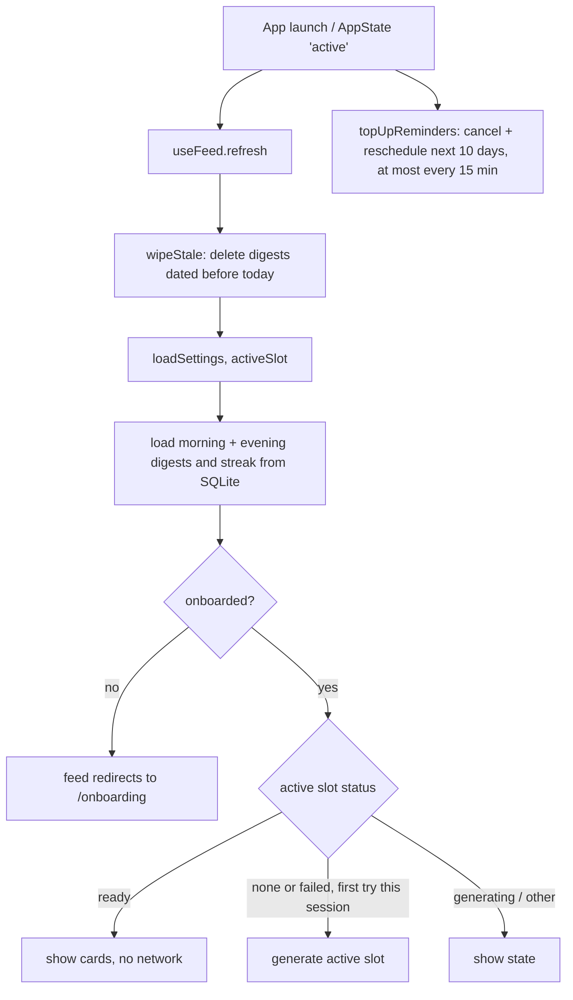

# Architecture

Owiwi is a single Expo app with no server. Screens in `app/` are thin; logic lives in `src/`. Pure logic (no Expo imports) is kept separate from code that touches SQLite, SecureStore, notifications or the network, so it can be unit tested with jest.

## Module map

### `app/` (expo-router screens)

| File | Purpose |
|---|---|
| `app/_layout.tsx` | Root stack. Boots the app (open DB, `refresh()`; notifications are configured and topped up in the background), subscribes to `AppState`, mounts the notification deep-link hook once the Stack is up, shows a "couldn't start" screen if boot fails or times out. |
| `app/index.tsx` | The feed: top bar (streak, slot tabs, menu), progress, and per-slot body (thinking, pager, empty, failed, or "Generate"). Redirects to onboarding until `onboarded = '1'`. |
| `app/onboarding.tsx` | Five-step first run: welcome, keywords, times, provider, notifications. |
| `app/bookmarks.tsx` | Saved stories (newest first) with Read more, Share, Remove + Undo; empty state with the idle owl. |
| `app/settings/index.tsx` | Settings home with summaries. |
| `app/settings/keywords.tsx` | Keyword CRUD (wraps `KeywordEditor`). |
| `app/settings/providers.tsx` | Provider list: set active, edit, delete (also deletes the key). |
| `app/settings/provider.tsx` | Add or edit one provider (wraps `ProviderForm`). |
| `app/settings/schedule.tsx` | Slot times, cards per digest, streak-saver nudge. |
| `app/settings/sources.tsx` | News source and locale. |

### `src/`

| Directory | Files | Expo-free | Purpose |
|---|---|---|---|
| `db/` | `client.ts`, `migrations.ts`, `queries.ts`, `settings.ts` | `migrations.ts`, `settings.ts` parsing | Lazily opened shared DB (`getDb()`), migration runner, typed queries, zod-validated settings. |
| `news/` | `types.ts`, `parse.ts`, `dedupe.ts`, `collect.ts`, `feed.ts`, `google.ts`, `bing.ts`, `publishers.ts`, `index.ts` | yes | `NewsSource` interface, RSS/Atom parsing (`fast-xml-parser`), dedupe, `collectArticles()`, the three sources, `getNewsSource()`. |
| `llm/` | `types.ts`, `adapters/*`, `defaultModels.ts`, `presets.ts`, `prompt.ts`, `schema.ts`, `validate.ts`, `testConnection.ts`, `index.ts` | yes | `LLMProvider` interface, three adapters, prompt builders, zod schema, `generateCards()`, `testConnection()`. See [llm.md](llm.md). |
| `digest/` | `generate.ts`, `guard.ts`, `retention.ts`, `slot.ts` | `guard.ts`, `retention.ts`, `slot.ts` | `generateDigest()` orchestration, generation decision, daily wipe, slot logic. |
| `streak/` | `streak.ts`, `index.ts` | yes | `computeStreak()`, `streakLost()`. |
| `notifications/` | `copy.ts`, `plan.ts`, `schedule.ts`, `deeplink.ts`, `index.ts` | `copy.ts`, `plan.ts` | Rotating copy, pure reminder plan, scheduling with `expo-notifications`, tap handling. |
| `store/` | `feed.ts`, `bookmarks.ts` | no | zustand stores: `useFeed` for the feed screen, `useBookmarks` (bookmarked urls, toggle/remove/restore). |
| `components/` | `Owiwi.tsx`, `owiwiAssets.ts`, `Pager.tsx`, `StoryCard.tsx`, `CompletionCard.tsx`, `KeywordEditor.tsx`, `ProviderForm.tsx`, `ui.tsx` | no | UI building blocks. |
| `lib/` | `dates.ts`, `errors.ts`, `http.ts`, `ids.ts`, `pool.ts`, `secureStore.ts`, `theme.ts`, `share.ts`, `shareStory.ts`, `bookmarks.ts` | all but `ids.ts`, `secureStore.ts`, `shareStory.ts` | Local dates, `AppError` and friendly messages, `fetchWithTimeout`, UUIDs, `mapWithConcurrency`, API key storage, colors, share message formatting and the RN share sheet, bookmark model helpers. |

## Opening the app



`app/_layout.tsx` runs `refresh()` once at boot and again on every `AppState` change to `active`. That single path handles the daily wipe, midnight rollover (the store detects that `today` changed and resets the viewed slot and `justCompleted`), a change of active slot, and topping up reminders. `refresh()` does not overwrite a slot that this process is currently generating.

### Boot and the splash screen

The native splash stays up until `boot()` in `app/_layout.tsx` settles, so nothing slow may sit on that path:

1. `getDb()` (open + migrate) and `refresh()` (wipe + read from SQLite) are the only awaited steps, each with an 8 s deadline (`withTimeout`, `src/lib/async.ts`). `refresh()` never awaits generation; it only starts it.
2. `configureNotifications()` and `topUpReminders()` run in the background, chained so the Android channel exists before scheduling.
3. The splash is hidden in `finally`, and a 10 s safety timer hides it regardless and shows the retry screen if the first boot is still loading.
4. Concurrency: `refresh()` and the reminder sync are wrapped with `coalesce()` (one run in flight, overlapping calls collapse into one trailing rerun), because a cold start from a notification fires boot and several `AppState` changes at once. `topUpReminders()` (used on boot and foreground) also skips if a sync ran in the last 15 minutes of the same day; settings screens call `syncReminders()` directly.
5. The notification deep link (`useNotificationDeepLink(navReady)`) only navigates after the Stack is mounted, remembers handled responses at module scope and clears the native last response. Before this, calling `router.replace('/')` while the root layout rendered its loading view made expo-router replace the root layout route itself; the remounted layout replayed the same (still stored) response and looped, pinning the JS thread behind the splash.

Auto-generation is attempted at most once per `(date, slot)` per process (`autoAttempted` in `src/store/feed.ts`). After a failure the reader sees retry UI rather than a loop.

## Generation pipeline

`generateDigest(db, { date, slot, force, onStep, signal })` in `src/digest/generate.ts`:

```
inFlight lock check ──busy──> { kind: 'busy' }
        │
wipeStale(db, date)
        │
decideGeneration(existing, now, force) ──use-cached──> { kind: 'ready', digestId }
        │                               ──busy───────> { kind: 'busy' }
        │ start
prerequisites: active provider, API key (SecureStore), >= 1 enabled keyword, settings
        │   (missing -> AppError no_provider / no_key / no_keywords, digest row untouched)
beginDigest  -> row status 'generating' (existing cards kept)
        │
onStep('fetching')  collectArticles(keywords, getNewsSource(rss_provider), { locale })
        │   0 articles -> new row deleted / regenerate restored -> { kind: 'empty' }
onStep('writing')   generateCards(createProvider(...), { system, user, allowedUrls, max })
        │   one LLM call, + one retry on unreadable JSON; 0 valid cards -> invalid_output
onStep('saving')    completeDigest(...)  one transaction: replace articles + cards, status 'ready'
        │
{ kind: 'ready', digestId, failedKeywords }
```

On any error after `beginDigest`, `restoreOrFail()` sets the row back to `ready` if it still has cards (a failed regenerate keeps the old digest), otherwise `failed`. Nothing partial is ever cached: articles and cards are only written inside `completeDigest`.

The step labels shown in the thinking state come from `STEP_LABEL`: "Fetching headlines", "Writing your gist", "Saving your digest".

### News collection

`collectArticles()` (`src/news/collect.ts`):

- Fetches keywords in parallel with `mapWithConcurrency`, limit 3.
- Each request uses `fetchWithTimeout` with a 10 s timeout (`FEED_TIMEOUT_MS`).
- A failing keyword is recorded in `failedKeywords` and skipped; it never fails the digest.
- Caps 15 items per keyword, then dedupes across keywords (`dedupeArticles`: normalized URL, then exact normalized title, then token Jaccard similarity >= 0.85; earlier keywords win).
- Caps the total at 60 with `capFairly` (round-robin across keywords).

## Generation guard

Three layers prevent double generation:

| Layer | Where | Rule |
|---|---|---|
| In-process lock | `inFlight` set in `src/digest/generate.ts` | One run per `date:slot` per JS process. |
| DB status | `decideGeneration()` in `src/digest/guard.ts` | A `generating` row younger than 2 minutes (`STALE_GENERATING_MS`) returns `busy`. Older is treated as stale (for example, the app was killed mid-run) and generation restarts. |
| Cache | same | A `ready` row is reused unless `force` is set (user-confirmed regenerate). A `failed` row may be retried. |

`beginDigest` updates `created_at` when it marks a row `generating`, so the 2-minute window is measured from the start of the current attempt.

## State store

`useFeed` (`src/store/feed.ts`, zustand) holds:

| Field | Meaning |
|---|---|
| `today`, `activeSlot`, `viewSlot` | Current local date, computed active slot, slot tab being viewed. |
| `settings` | Parsed settings. |
| `slots.morning`, `slots.evening` | `SlotState`: `status` (`none`, `loading`, `generating`, `ready`, `empty`, `failed`), `cards`, `step`, `error`, `failedKeywords`. |
| `streak` | `current`, `doneToday`, `lost`. |
| `justCompleted` | Set when this session completed the day. |

Actions: `refresh()`, `setViewSlot()`, `generate(slot, force?)`, `completeDay(slot)`. `completeDay` records the streak day (idempotent), reloads the streak and cancels today's streak-saver nudge.

Settings screens write through `saveSettings()` and then call `refresh()` (and `syncReminders()` when times change).

## Offline behaviour

- A ready digest for today is read from SQLite only. Opening the app offline shows it.
- `syncReminders()` is local and works offline.
- Generation offline fails every keyword fetch, which yields the empty state (no LLM call). If a previous digest exists for that slot it is kept.

## Error handling

- All user-facing errors are `AppError` (`src/lib/errors.ts`) with a fixed friendly message per kind: `auth`, `rate_limit`, `network`, `timeout`, `bad_request`, `server`, `invalid_output`, `no_provider`, `no_key`, `no_keywords`, `busy`, `unknown`.
- HTTP status mapping (`errorFromStatus`): 401/403 -> `auth`, 429 -> `rate_limit`, 5xx -> `server`, other -> `bad_request`.
- `friendlyMessage()` / `toAppError()` turn anything else into a safe message: `AbortError` -> timeout, `TypeError` (fetch failure) -> network, otherwise unknown.
- Messages never include the API key, request bodies or provider responses. `src/llm/adapters/http.ts` builds errors only from the status code; a test asserts the key does not leak.
- Notification failures are logged with `console.warn` (short message only) and never thrown.
- If the database fails to open or the first load times out at boot, `app/_layout.tsx` hides the splash and shows a retry screen.
- RSS and LLM text is rendered only as React Native `Text`, never as HTML.
